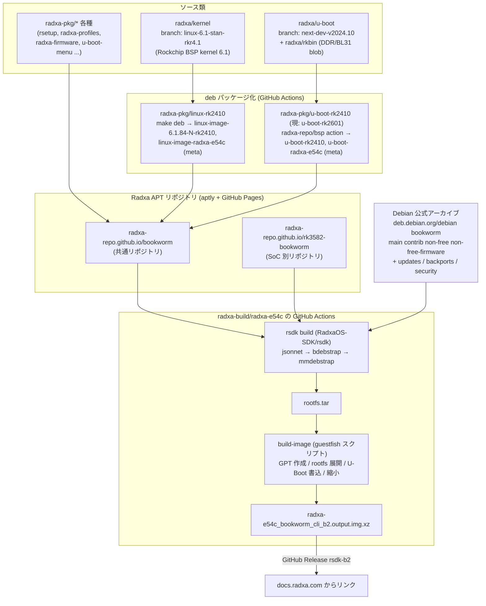

# 01. ビルドパイプライン全体像

## 一言でいうと

`radxa-e54c_bookworm_cli_b2.output.img.xz` は、
**素の Debian bookworm(deb.debian.org)を mmdebstrap で bootstrap し、Radxa の APT リポジトリから
カーネル(Rockchip ベンダー 6.1)・U-Boot・ボード設定の deb を追加インストールした rootfs** を、
**guestfish で GPT イメージに書き込み、U-Boot を固定オフセットに焼き込んだもの**。

Yocto や buildroot のようなソースからの全ビルドではなく、「Debian バイナリアーカイブ + 独自 APT リポジトリの上乗せ」
という Raspberry Pi OS などと同系統の構成。

## 全体フロー

## 登場リポジトリ一覧

| リポジトリ | 役割 |
|---|---|
| [radxa-build/radxa-e54c](https://github.com/radxa-build/radxa-e54c) | ビルド用 GitHub Actions ワークフローの置き場 + イメージのリリース(ホスティング)。中身はワークフロー 2 本と README のみ |
| [RadxaOS-SDK/rsdk](https://github.com/RadxaOS-SDK/rsdk) | イメージビルダー本体(旧 rbuild / debos-radxa の後継)。jsonnet で bdebstrap 設定と guestfish スクリプトを生成 |
| [bdebstrap](https://github.com/bdrung/bdebstrap) / mmdebstrap | Debian rootfs の bootstrap 実行系(Debian 公式ツール)。rsdk が生成した YAML/JSON 設定を実行する |
| [radxa-repo/bsp](https://github.com/radxa-repo/bsp) | カーネル・U-Boot を deb 化する標準ビルドツール(GitHub Action としても利用) |
| [radxa/kernel](https://github.com/radxa/kernel) | Rockchip ベンダーカーネルの Radxa フォーク(E54C は `linux-6.1-stan-rkr4.1`) |
| [radxa/u-boot](https://github.com/radxa/u-boot) | Rockchip ベンダー U-Boot(2017.09 系)の Radxa フォーク(`next-dev-v2024.10`) |
| [radxa/rkbin](https://github.com/radxa/rkbin) | Rockchip のバイナリブロブ(DDR init、BL31 など) |
| [radxa-pkg/linux-rk2410](https://github.com/radxa-pkg/linux-rk2410) | カーネル deb パッケージング(radxa/kernel を submodule で参照) |
| [radxa-pkg/u-boot-rk2410](https://github.com/radxa-pkg/u-boot-rk2410) ほか | U-Boot deb パッケージング(bsp を呼ぶ薄いリポジトリ) |
| [radxa-pkg/*](https://github.com/orgs/radxa-pkg/repositories) | rsetup, radxa-profiles(task-radxa-e54c), radxa-firmware, radxa-overlays など周辺パッケージ群 |
| [radxa-repo/*](https://github.com/orgs/radxa-repo/repositories) | APT リポジトリ本体(aptly 生成物を GitHub Pages で配信)と update-repo-action |

## ビルドの 2 段階

rsdk のビルド(`rsdk build radxa-e54c bookworm cli`)は大きく 2 段階:

1. **rootfs 生成** — `rootfs.jsonnet` から bdebstrap 設定(JSON)を生成し、`bdebstrap`(内部で `mmdebstrap`)を実行。
   出力は `rootfs.tar` と、実行に使った設定 `config.yaml`、パッケージ一覧 `manifest`。
   → 詳細は [03-rootfs.md](03-rootfs.md)
2. **イメージ生成** — `image.jsonnet` から guestfish スクリプト `build-image` を生成して実行。
   GPT パーティション作成 → rootfs.tar 展開 → fstab/extlinux.conf の UUID 書き換え → ファイルシステム縮小 →
   U-Boot を固定セクタへ書き込み。出力が `output.img`。
   → 詳細は [04-image.md](04-image.md)

CI ではこの 2 段階を GitHub Actions ランナー上の devcontainer 内で実行し、生成物を `xz` 圧縮して
GitHub Release に添付している。→ [02-github-actions-release.md](02-github-actions-release.md)
